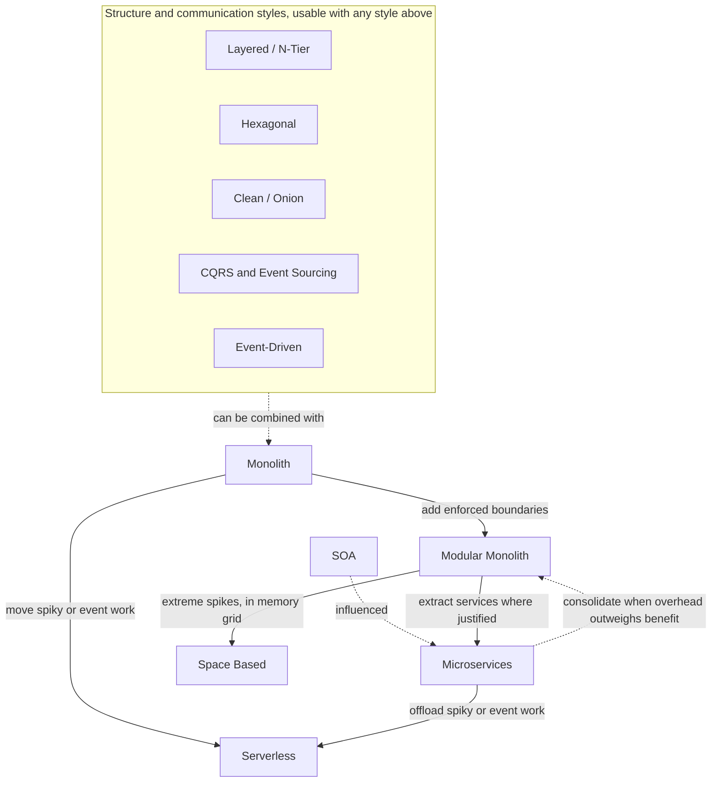

# Solution Architecture Patterns

[](LICENSE)
[](CONTRIBUTING.md)

A neutral, plain language guide to the main software solution architectures. For each pattern you get a diagram, how it works, honest pros and cons, when to use it, when to avoid it, and what it costs in the real world.

## Purpose

Architecture discussions often turn into arguments about which style is "best". This repository takes a different view: **every pattern is a set of trade offs, and none is the best choice for everyone.** The goal is to help teams, students, and decision makers:

* Understand what each pattern is, in everyday language.
* See the real costs next to the benefits.
* Choose a starting point that fits their team, domain, and constraints.
* Record decisions clearly, using a simple ADR (architecture decision record) format.

> **Patterns are not all alternatives to each other.** Monolith, Modular Monolith, Microservices, Serverless, SOA, and Space Based describe how a system is **deployed and scaled**. Layered, Hexagonal, Clean / Onion, and CQRS describe how code is **structured**, and Event Driven describes how parts **communicate**. The structural and communication styles can be combined with deployment styles. For example, a microservice can use Hexagonal structure, publish events, and run on serverless infrastructure.

## The patterns

| # | Pattern | Kind | In one line | Best for |
|---|---|---|---|---|
| 1 | [Monolith](docs/01-monolith.md) | Deployment | One codebase, deployed as one unit. | Early products, small teams, simple domains |
| 2 | [Modular Monolith](docs/02-modular-monolith.md) | Deployment | One deployable, with enforced module boundaries inside. | Growing teams that want structure without distributed systems |
| 3 | [Microservices](docs/03-microservices.md) | Deployment | Many small services, each owning its data and deployed on its own. | Many teams, clear domains, mature operations |
| 4 | [Serverless](docs/04-serverless.md) | Deployment | Short lived functions and managed services, billed by use. | Spiky or event triggered workloads, small teams |
| 5 | [Event-Driven Architecture](docs/05-event-driven-architecture.md) | Communication | Components announce events and others react. | Decoupled integrations, asynchronous workflows, bursty load |
| 6 | [Hexagonal (Ports & Adapters)](docs/06-hexagonal-architecture.md) | Structure | Business core isolated from technology behind ports and adapters. | Long lived domains, fast tests, swappable infrastructure |
| 7 | [CQRS & Event Sourcing](docs/07-cqrs-and-event-sourcing.md) | Structure and data | Separate read and write models, and state stored as events. | Audit heavy, complex domains, or very different read and write loads |
| 8 | [Layered / N-Tier](docs/08-layered-n-tier.md) | Structure | Code in horizontal layers, optionally on separate tiers. | Conventional business applications, familiar patterns |
| 9 | [Clean / Onion Architecture](docs/09-clean-onion-architecture.md) | Structure | Concentric rings where dependencies point inward. | Complex, long lived domains that must outlast frameworks |
| 10 | [Service-Oriented Architecture (SOA)](docs/10-service-oriented-architecture.md) | Deployment and integration | Reusable enterprise services with shared contracts, often through a bus. | Large organizations integrating many existing systems |
| 11 | [Space-Based Architecture](docs/11-space-based-architecture.md) | Deployment | In memory data grids with replicated processing units. | Extreme, unpredictable spikes where the database is the bottleneck |

## Quick comparison

Broad generalizations, not scores. See the [detailed comparison](docs/comparison.md) for more.

| Pattern | Simple to start | Operational effort | Independent scaling | Team autonomy |
|---|---|---|---|---|
| Monolith | High | Low | Low | Low |
| Modular Monolith | Medium | Low | Low | Medium |
| Microservices | Low | High | High | High |
| Serverless | Medium | Medium | High | Medium to high |
| Event-Driven | Medium | Medium to high | High | High |
| Hexagonal | Medium | Low | Not applicable | Not applicable |
| CQRS & Event Sourcing | Low | Medium to high | Medium to high | Medium |
| Layered / N-Tier | High | Low | Low | Low |
| Clean / Onion | Medium | Low | Not applicable | Not applicable |
| SOA | Low | Medium to high | Medium | Medium |
| Space-Based | Low | High | Very high | Low |

"Not applicable" means the pattern only describes internal code structure.

## How architectures evolve

Teams move between styles in several directions, and many successful systems never move at all. The diagram shows common paths, **not a ladder you are supposed to climb**. Consolidating services back together is as legitimate as splitting a monolith apart.



If the diagram does not render in your viewer, use the [exported SVG](assets/diagrams/architecture-evolution.svg).

## Also in this repository

* [Comparison](docs/comparison.md): side by side tables and an illustrative complexity chart.
* [Decision guide](docs/decision-guide.md): a flowchart, questions to ask, and common anti patterns.
* [Glossary](docs/glossary.md): plain language definitions of terms such as ACID, eventual consistency, saga, and idempotency.
* [Case studies](docs/case-studies/README.md): short, sourced migration examples.
* [Architecture decision records](docs/adr/0000-adr-template.md): a template and a [worked example](docs/adr/0001-start-as-a-modular-monolith.md).
* [Pattern template](templates/pattern-template.md): the starting point for adding a new pattern page.

## Repository layout

```text
solution-architecture-patterns/
├── README.md
├── CONTRIBUTING.md
├── CODE_OF_CONDUCT.md
├── SECURITY.md
├── LICENSE
├── .markdownlint.json
├── .github/
│   ├── PULL_REQUEST_TEMPLATE.md
│   ├── ISSUE_TEMPLATE/
│   │   ├── config.yml
│   │   ├── bug-or-correction.yml
│   │   └── new-pattern-request.yml
│   └── workflows/
│       └── markdown-lint.yml
├── docs/
│   ├── 01-monolith.md
│   ├── 02-modular-monolith.md
│   ├── 03-microservices.md
│   ├── 04-serverless.md
│   ├── 05-event-driven-architecture.md
│   ├── 06-hexagonal-architecture.md
│   ├── 07-cqrs-and-event-sourcing.md
│   ├── 08-layered-n-tier.md
│   ├── 09-clean-onion-architecture.md
│   ├── 10-service-oriented-architecture.md
│   ├── 11-space-based-architecture.md
│   ├── comparison.md
│   ├── decision-guide.md
│   ├── glossary.md
│   ├── adr/
│   └── case-studies/
├── templates/
│   └── pattern-template.md
├── assets/
│   └── diagrams/
└── scripts/
    └── render-diagrams.sh
```

## Contributing

Corrections, clearer explanations, better diagrams, and new patterns are welcome. Please read [CONTRIBUTING.md](CONTRIBUTING.md) first, and note the [Code of Conduct](CODE_OF_CONDUCT.md). The most important rules: stay neutral, be honest about costs, cite sources for factual claims, and write in your own words.

## License

Released under the [MIT License](LICENSE).
