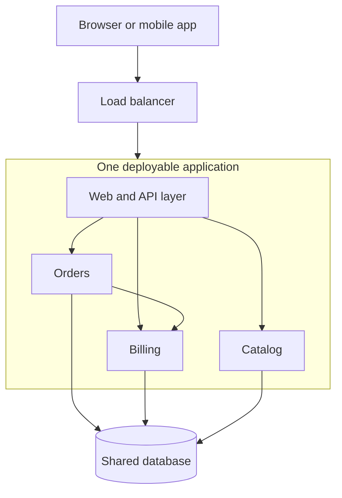

# 1. Monolith

[All patterns](../README.md#the-patterns) | [Next: Modular Monolith](02-modular-monolith.md)

**Category:** Deployment and scaling style

## Overview

A monolith is an application built and deployed as a single unit. All features live in one codebase, run in one process (or several identical copies of it), and usually share one database. "Monolith" describes how the system is packaged and shipped. It does not say whether the code inside is tidy or messy.

## Diagram

To scale, you run more copies of the whole application behind the load balancer.

## How it works

* One repository, one build, one deployable artifact.
* Features call each other with ordinary function calls inside the same process.
* One database holds all the data, so a single transaction can touch many features at once.
* Scaling means running more identical copies of the whole application, or giving it a bigger machine.

## Pros

* **Simple to start:** One project to create, run, test, and deploy. There is little to learn before shipping.
* **Easy local development:** One command can start everything on a laptop.
* **Fast calls:** In process calls are far cheaper and more reliable than network calls.
* **Simple data consistency:** A single database makes ACID transactions straightforward. See the [glossary](glossary.md).
* **Easy debugging:** One stack trace, one log stream, and one place to attach a debugger.
* **Cheap to run:** Fewer moving parts means less infrastructure and less operational work.
* **Easy refactoring:** Compilers, IDEs, and tests can follow a change across the whole codebase.

## Cons

* **Boundaries erode:** Nothing stops one feature from reaching into another, so coupling tends to grow unless the team guards against it.
* **Scaling is all or nothing:** A hot feature forces you to scale everything, even parts that are idle.
* **Larger blast radius:** A bad deploy, memory leak, or crash can affect every feature at once.
* **Slower builds and tests over time:** The whole system is built and tested together, so feedback loops lengthen as the code grows.
* **Team contention:** Many teams working in one codebase and one release train can block each other.
* **Technology lock in:** The whole application usually shares one language and framework version, which makes upgrades big events.

## When to use

* You are starting a new product and the domain is still being discovered.
* The team is small, or the product has one main team.
* The application is mostly create, read, update, and delete work with moderate traffic.
* You want to ship quickly with minimal infrastructure.
* Strong consistency across features matters more than independent scaling.

## When to avoid

* Different parts of the system have wildly different scaling or availability needs.
* Many teams need to release on their own schedules without coordinating.
* Parts of the system need different runtimes or hardware, such as GPU workloads next to a simple web app.
* A regulatory or security rule requires strict isolation between components.

## Common technologies

| Area | Examples |
|---|---|
| Web frameworks | Laravel, Ruby on Rails, Django, Spring Boot, ASP.NET Core, Express, NestJS |
| Databases | PostgreSQL, MySQL, SQL Server |
| Hosting | A virtual machine, a managed platform, or a single container image |
| Scaling aids | Load balancers, read replicas, caches such as Redis |

## Real world considerations

| Factor | What to expect |
|---|---|
| Team size | Works well from one developer up to a few teams. Past that, coordination costs rise unless the code is modular. |
| Operational maturity | Low to moderate. Basic deployment, backups, and monitoring are enough to start. |
| Cost | Usually the lowest infrastructure and tooling cost. The hidden cost is slower change if coupling is left unchecked. |

A monolith is not the same as a "big ball of mud". A well organized monolith with clear internal boundaries is a legitimate and common choice. That middle ground has its own page: [Modular Monolith](02-modular-monolith.md).

## Related patterns

* [Modular Monolith](02-modular-monolith.md): the same single deployment, with enforced internal boundaries.
* [Layered / N Tier](08-layered-n-tier.md): the most common way to organize the inside of a monolith.
* [Microservices](03-microservices.md): the usual alternative when teams and scaling needs outgrow one deployable.
* [Comparison](comparison.md): side by side tables for all patterns.
