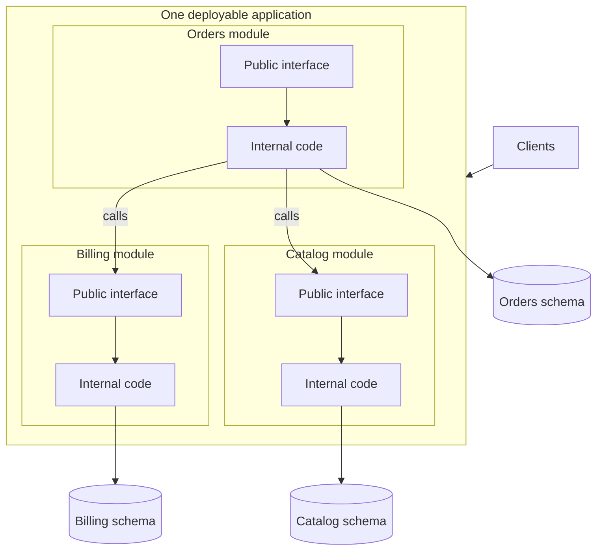

# 2. Modular Monolith

[Previous: Monolith](01-monolith.md) | [All patterns](../README.md#the-patterns) | [Next: Microservices](03-microservices.md)

**Category:** Deployment and scaling style, with a strong structural element

## Overview

A modular monolith is still deployed as one unit, but the code inside is split into modules with clear boundaries. Each module exposes a small public interface and hides everything else, including its data. You get much of the organization of separate services without paying for a network between them.

## Diagram

Modules may share one database server, but each owns its own tables or schema.

## How it works

* The codebase is divided by business capability (orders, billing, catalog), not by technical layer.
* Each module has a public interface. Other modules may only call that interface.
* Each module owns its data. Other modules do not read or write its tables directly.
* Tooling or automated tests enforce the rules, so the boundaries survive deadline pressure.
* Modules can talk through direct calls or through in process events.

## Pros

* **Clear ownership:** Teams can own modules, and new developers only need to learn the module they work in.
* **Simple operations:** There is one deployment, one pipeline, and one thing to monitor.
* **Cheap refactoring:** Moving a boundary is a code change, not a cross service migration.
* **Keeps transactions simple:** A shared database still allows ACID transactions where you truly need them.
* **A path forward:** Well bounded modules are the natural candidates to extract into services later, if that ever becomes necessary.

## Cons

* **Boundaries need discipline:** Without automated enforcement, modules slowly become tangled again.
* **Still one deployable:** One module's bug or slow build can affect the whole release.
* **Shared runtime:** Modules cannot scale independently, and they share one language and framework version.
* **Data coupling is easy to sneak in:** A shared database makes cross module joins tempting.
* **Tooling varies by ecosystem:** Some platforms have good boundary checking tools, others have little.
* **Boundaries can be wrong:** Drawing them early, before the domain is understood, can lock in poor splits.

## When to use

* You want team autonomy and clean design, but not the operational cost of distributed systems.
* The product is growing and a plain monolith is starting to hurt.
* You expect to split out a few services later and want to prepare cheaply.
* The team is mid sized and does not have a mature platform or on call practice for many services.

## When to avoid

* The team will not enforce boundaries. In that case the extra structure is just ceremony.
* Parts of the system need independent scaling, separate runtimes, or separate release schedules right now.
* The application is a small prototype where module overhead slows you down.

## Common technologies

| Area | Examples |
|---|---|
| Boundary checking | Packwerk (Ruby), ArchUnit (Java), Deptrac (PHP), NetArchTest (.NET), Nx module boundary rules (JavaScript and TypeScript) |
| Module frameworks | Spring Modulith (Java), Rails Engines, Laravel packages used as internal modules |
| In process messaging | Domain events, mediator libraries, internal event buses |
| Data | One database server with a separate schema or table prefix per module |

## Real world considerations

| Factor | What to expect |
|---|---|
| Team size | Suits a few teams up to a few dozen developers. Each team can own one or more modules. |
| Operational maturity | Low to moderate. Operations stay close to a plain monolith. The extra skill needed is design and code review discipline. |
| Cost | Infrastructure cost stays low. The investment is in design time, boundary tooling, and code review. |

Shopify's move to a modular monolith is documented in the [case study](case-studies/02-shopify-modular-monolith.md). The article describing it states that complete isolation was still work in progress, which is a realistic expectation.

## Related patterns

* [Monolith](01-monolith.md): the starting point without enforced boundaries.
* [Microservices](03-microservices.md): the possible next step if modules need independent deployment.
* [Hexagonal](06-hexagonal-architecture.md) and [Clean / Onion](09-clean-onion-architecture.md): ways to structure the inside of each module.
* [ADR example: start as a modular monolith](adr/0001-start-as-a-modular-monolith.md)
