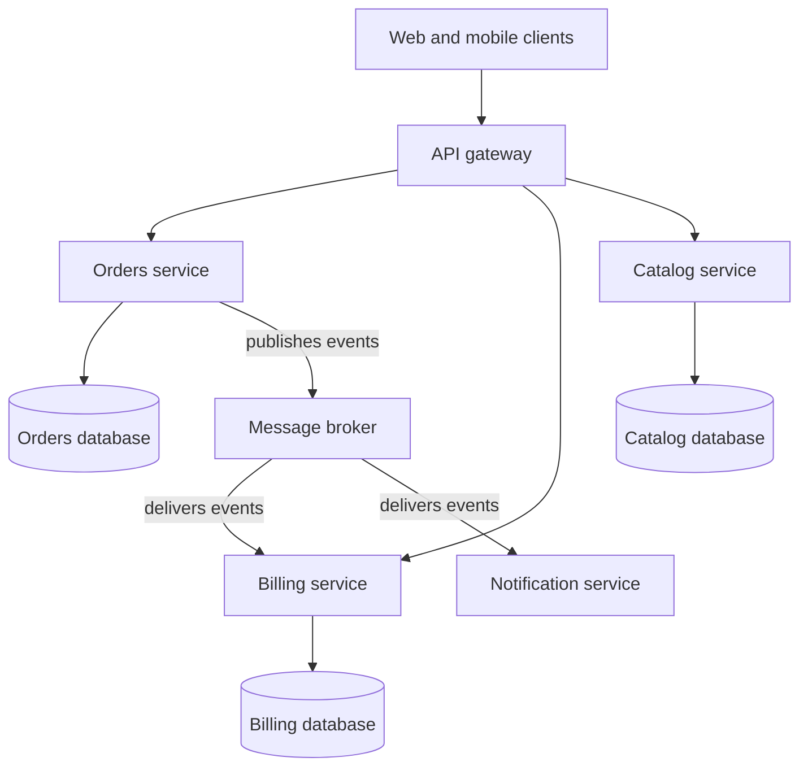

# 3. Microservices

[Previous: Modular Monolith](02-modular-monolith.md) | [All patterns](../README.md#the-patterns) | [Next: Serverless](04-serverless.md)

**Category:** Deployment and scaling style

## Overview

Microservices split an application into many small services. Each one covers a business capability, runs as its own process, owns its own data, and can be deployed independently. Services talk to each other over the network. The goal is to let teams change and scale their part of the system without coordinating every release with everyone else.

## Diagram

## How it works

* Each service owns one business capability and its data. No other service touches its database.
* Services expose APIs, commonly HTTP or gRPC, and sometimes exchange events through a broker.
* Each service has its own repository or folder, build pipeline, and deployment.
* A gateway or service mesh handles routing, authentication, and traffic control.
* Cross service workflows use patterns such as sagas instead of one big transaction. See the [glossary](glossary.md).

## Pros

* **Independent deployment:** A team can ship its service without waiting for others.
* **Independent scaling:** You scale only the services that need it.
* **Fault isolation:** A failure in one service can be contained if the others are designed to cope.
* **Team autonomy:** Teams own their service end to end, including technology choices within agreed limits.
* **Smaller codebases:** Each service is easier to understand in full.
* **Technology fit:** A service can use the language or datastore that suits it best.

## Cons

* **Distributed system complexity:** Networks fail, calls time out, and partial failures become normal. Every call needs timeouts, retries, and idempotency.
* **Data consistency is harder:** There are no cross service ACID transactions. You live with eventual consistency and compensating actions.
* **Operational overhead:** Many deployables mean more pipelines, dashboards, alerts, and on call surface.
* **Harder debugging and testing:** A single request can cross many services, so you need tracing and contract tests.
* **Wrong boundaries are expensive:** Poorly chosen service splits cause constant cross service changes, which is the "distributed monolith" anti pattern. See the [decision guide](decision-guide.md).
* **Latency and cost:** Network hops add latency, and data moving between services can add real cost.
* **Needs organizational fit:** The benefits depend on teams being able to work independently.

## When to use

* Many teams need to deploy independently and frequently.
* Parts of the system have clearly different scaling, availability, or security needs.
* The domain is well understood, so service boundaries are unlikely to move often.
* The organization already has solid automation, observability, and on call practices, or is ready to invest in them.

## When to avoid

* The team is small, or the product is new and the domain is still changing.
* You do not have automated deployment, centralized logging, and monitoring.
* Most features must change together and need strong consistency.
* The main motivation is fashion or a belief that it is "more modern".

## Common technologies

| Area | Examples |
|---|---|
| Packaging and orchestration | Docker, Kubernetes, Amazon ECS, Nomad |
| Communication | REST, gRPC, GraphQL gateways, Apache Kafka, RabbitMQ, NATS |
| Traffic management | API gateways, Envoy, Istio, Linkerd |
| Observability | OpenTelemetry, Prometheus, Grafana, Jaeger |
| Contracts and testing | OpenAPI, Protocol Buffers, Pact |

## Real world considerations

| Factor | What to expect |
|---|---|
| Team size | Tends to pay off when there are many teams. For a handful of developers the overhead often outweighs the benefit. |
| Operational maturity | High. You need automated delivery, strong monitoring and tracing, incident response, and often a platform team. |
| Cost | Higher baseline for infrastructure, tooling, and people. Savings come from targeted scaling, which only matters at sufficient scale. |

Two documented stories show both sides. Segment consolidated an overgrown set of per destination services back into one service, and Prime Video merged parts of a distributed workflow into a single process. See the [Segment](case-studies/03-segment-microservices-to-monolith.md) and [Prime Video](case-studies/01-prime-video-serverless-to-ecs.md) case studies. Both are about specific workloads and do not show that microservices are wrong in general.

Microservices describe a deployment style. They combine with structural styles such as [Hexagonal](06-hexagonal-architecture.md) or [Clean](09-clean-onion-architecture.md), and with communication styles such as [Event Driven](05-event-driven-architecture.md).

## Related patterns

* [Monolith](01-monolith.md) and [Modular Monolith](02-modular-monolith.md): the alternatives to compare against first.
* [Service Oriented Architecture](10-service-oriented-architecture.md): an earlier, enterprise focused take on services.
* [Event Driven Architecture](05-event-driven-architecture.md): a common way for services to communicate.
* [Serverless](04-serverless.md): another way to run many small units of code.
* [CQRS & Event Sourcing](07-cqrs-and-event-sourcing.md): often used inside individual services.
