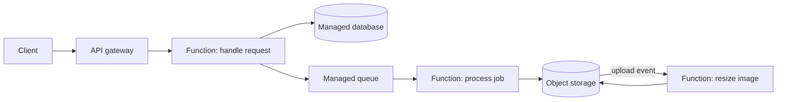

# 4. Serverless

[Previous: Microservices](03-microservices.md) | [All patterns](../README.md#the-patterns) | [Next: Event Driven Architecture](05-event-driven-architecture.md)

**Category:** Deployment and scaling style

## Overview

Serverless means you write code and configuration, and a cloud provider runs the servers for you. Code usually runs as short lived functions triggered by events such as web requests, queue messages, or file uploads. You combine those functions with managed services such as databases, queues, and storage. You pay for what runs rather than for machines that sit idle. Servers still exist. You just do not manage them.

## Diagram

## How it works

* Each function does one job and starts when an event arrives.
* The provider creates and destroys execution environments automatically, including scaling to zero when nothing is happening.
* Functions are stateless. State lives in managed databases, queues, caches, or storage.
* Triggers come from gateways, queues, schedules, storage events, and similar sources.
* Infrastructure is defined as code so environments can be reproduced.
* Serverless also covers managed containers that scale to zero, not only functions.

## Pros

* **No server management:** Patching, capacity planning, and scaling the machines are the provider's job.
* **Automatic scaling:** Capacity follows demand, including sudden spikes, within provider limits.
* **Pay per use:** Spiky or low traffic workloads can be very cheap, because idle time costs little or nothing.
* **Fast to start:** A small team can ship a working service with very little infrastructure work.
* **Good fit for event handling:** Glue code, file processing, and scheduled jobs map naturally to functions.

## Cons

* **Vendor lock in:** Triggers, permissions, and managed services are provider specific, so moving is costly.
* **Cold starts:** The first request after idle time can be slower, which matters for latency sensitive paths.
* **Execution limits:** Functions have limits on run time, memory, payload size, and concurrency.
* **Cost can flip at steady high load:** Constant, heavy traffic can cost more than running reserved servers.
* **Harder local development and testing:** Behavior depends on cloud services that are awkward to reproduce locally.
* **Observability gaps:** A request may cross many functions and services, so you need distributed tracing and good logging.
* **Downstream pressure:** Fast scaling functions can overwhelm databases that were not designed for sudden connection spikes.
* **Workflow sprawl:** Many small functions plus orchestration can become hard to understand and expensive in coordination calls.

## When to use

* Traffic is unpredictable, spiky, or often idle.
* The work is event driven: file processing, webhooks, scheduled jobs, or queue consumers.
* A small team wants to deliver quickly without owning infrastructure.
* You are building glue between managed services.

## When to avoid

* You have steady, high, predictable load where reserved capacity is cheaper.
* Latency must be consistently very low and cold starts are unacceptable.
* Jobs run for a long time or need specialized hardware or large in memory state.
* You must avoid dependence on a single provider's services.
* The system moves large amounts of data between steps, where per step charges and data transfer add up.

## Common technologies

| Area | Examples |
|---|---|
| Function platforms | AWS Lambda, Azure Functions, Google Cloud Functions, Cloudflare Workers |
| Serverless containers | Google Cloud Run, AWS Fargate, Azure Container Apps |
| Orchestration | AWS Step Functions, Azure Durable Functions |
| Managed data and messaging | DynamoDB, Amazon SQS and SNS, Google Pub/Sub, Azure Service Bus |
| Tooling | AWS SAM, Serverless Framework, SST, Terraform, Pulumi |

## Real world considerations

| Factor | What to expect |
|---|---|
| Team size | Works for tiny teams and large ones. Small teams benefit most from not running servers. |
| Operational maturity | Moderate. Less server work, but you still need monitoring, tracing, cost tracking, and infrastructure as code. |
| Cost | Very low at small or spiky scale. Watch per request charges, orchestration charges, and data transfer as volume grows. |

Prime Video documented a case where one workload that began on a serverless orchestration moved to a different design because of cost and scaling limits. The [case study](case-studies/01-prime-video-serverless-to-ecs.md) also covers how that example is disputed and what it does not show.

Serverless is a deployment style. It combines with [Event Driven](05-event-driven-architecture.md) designs and with structural styles such as [Hexagonal](06-hexagonal-architecture.md), which helps keep business logic separate from provider specific code.

## Related patterns

* [Microservices](03-microservices.md): similar goals with servers or containers that you run yourself.
* [Event Driven Architecture](05-event-driven-architecture.md): the natural trigger model for serverless.
* [Hexagonal](06-hexagonal-architecture.md): a way to limit lock in by isolating provider code in adapters.
* [Space Based Architecture](11-space-based-architecture.md): another approach to elastic scaling, with a very different trade off.
