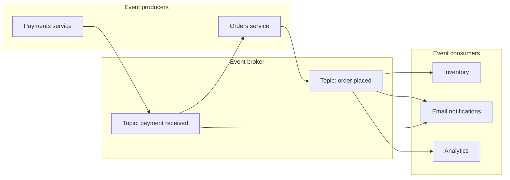

# 5. Event-Driven Architecture

[Previous: Serverless](04-serverless.md) | [All patterns](../README.md#the-patterns) | [Next: Hexagonal](06-hexagonal-architecture.md)

**Category:** Communication style

## Overview

In an event driven system, components communicate by announcing that something happened, such as "order placed", instead of calling each other directly. Other components listen for the events they care about and react in their own time. The sender does not need to know who is listening, which loosens the coupling between parts.

## Diagram

## How it works

* A producer publishes an event, which is an immutable fact about something that already happened.
* A broker or event log delivers the event to any number of subscribers.
* Consumers process events on their own schedule and may publish new events in response.
* Events can carry just an identifier, a notification, or a full copy of the changed data.
* Delivery is usually "at least once", so consumers must handle duplicates. See idempotency in the [glossary](glossary.md).

## Pros

* **Loose coupling:** Producers do not know their consumers, so you can add new consumers without changing producers.
* **Absorbs spikes:** A broker buffers bursts, and consumers work through them at their own pace.
* **Resilience to downtime:** A consumer that is offline can catch up later, instead of causing the producer to fail.
* **Independent scaling:** Each consumer scales according to its own backlog.
* **Natural audit trail:** Events show what happened and when, and can feed analytics or other systems.

## Cons

* **Eventual consistency:** Different parts of the system see changes at different times, which complicates user experience and reasoning.
* **Hard to follow the flow:** Behavior is spread across independent handlers, and no single place shows the whole business process.
* **Debugging and tracing are harder:** You need correlation IDs, tracing, and good tooling to follow an event through the system.
* **Duplicates and ordering:** Consumers must cope with repeated, delayed, or out of order events.
* **Event design is a long term contract:** Changing the shape of events affects every consumer, so versioning needs planning.
* **Hidden coupling:** Consumers can quietly depend on event details, so changes can break them without any compile time warning.
* **Broker operations:** The broker becomes critical infrastructure that must be run, secured, and monitored.

## When to use

* Many components need to react to the same business facts.
* Work can happen asynchronously, and users do not need an instant final result.
* You need to integrate separate systems or teams without tight coupling.
* Traffic is bursty and buffering helps.

## When to avoid

* The workflow needs an immediate, strongly consistent answer, such as a simple balance check followed by a debit.
* The system is small and direct calls would be simpler and easier to trace.
* The team lacks tracing, monitoring, and a habit of designing for duplicates.
* Everything is one tightly connected process that would gain nothing from decoupling.

## Common technologies

| Area | Examples |
|---|---|
| Event logs and brokers | Apache Kafka, RabbitMQ, NATS, Redis Streams, Apache Pulsar |
| Cloud messaging | Amazon SNS, SQS and EventBridge, Azure Service Bus and Event Grid, Google Pub/Sub |
| Event formats and docs | CloudEvents, AsyncAPI, Avro, Protocol Buffers, JSON Schema |
| Integration helpers | Debezium for change data capture, schema registries |

## Real world considerations

| Factor | What to expect |
|---|---|
| Team size | Useful when several teams need to react to shared facts. Needs agreement on event naming and ownership. |
| Operational maturity | Moderate to high. You need broker operations, monitoring of lag and dead letter queues, and good tracing. |
| Cost | Broker infrastructure and operations, plus the design effort to define and version events. |

Event driven architecture describes how parts communicate. It is not a deployment style, so it can sit inside a [Modular Monolith](02-modular-monolith.md) as in process events, or connect [Microservices](03-microservices.md) and [Serverless](04-serverless.md) functions. It also combines with [CQRS & Event Sourcing](07-cqrs-and-event-sourcing.md), but those are separate decisions.

## Related patterns

* [CQRS & Event Sourcing](07-cqrs-and-event-sourcing.md): event sourcing stores events as the source of truth, while event driven architecture only uses them for communication.
* [Microservices](03-microservices.md): a common place to use events between services.
* [Serverless](04-serverless.md): functions are often triggered by events.
* [Service Oriented Architecture](10-service-oriented-architecture.md): earlier integration style that often used message buses.
* [Space Based Architecture](11-space-based-architecture.md): uses asynchronous messaging and data replication to scale.
