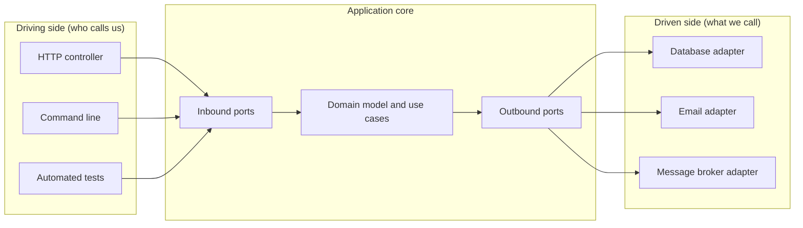

# 6. Hexagonal (Ports & Adapters)

[Previous: Event Driven Architecture](05-event-driven-architecture.md) | [All patterns](../README.md#the-patterns) | [Next: CQRS & Event Sourcing](07-cqrs-and-event-sourcing.md)

**Category:** Structural style (how the code inside an application is organized)

## Overview

Hexagonal architecture, also called ports and adapters, puts the business logic in the center and keeps technology details at the edges. The core defines "ports", which are interfaces describing what it offers and what it needs. "Adapters" plug into those ports to connect the core to web frameworks, databases, message queues, or test code. The core never depends on the outside. The outside depends on the core. The pattern is closely associated with Alistair Cockburn, who named and popularized it.

## Diagram

## How it works

* The core holds domain rules and use cases. It has no imports from web, database, or messaging libraries.
* Inbound ports describe the operations the core offers, such as "place an order".
* Outbound ports describe what the core needs, such as "save an order" or "send a receipt".
* Adapters implement or call those ports. A database adapter implements the "save" port, and a controller calls the "place an order" port.
* In tests, you swap real adapters for in memory fakes and run the core quickly.

## Pros

* **Highly testable:** Business rules can be tested without a database, web server, or network.
* **Replaceable infrastructure:** Switching a database, queue, or framework mostly means writing a new adapter.
* **Protects the domain:** Framework upgrades and vendor changes are less likely to leak into business code.
* **Many entry points, one core:** Web, command line, queue consumers, and scheduled jobs can all reuse the same use cases.
* **Clear dependency direction:** Everyone knows where code is allowed to point.

## Cons

* **More code and indirection:** Interfaces, adapters, and mapping between models add files and ceremony.
* **Overkill for simple apps:** A basic form over a table gains little from this structure.
* **Mapping overhead:** Translating between domain objects and database or API shapes takes effort and can be tedious.
* **Easy to over abstract:** Teams sometimes create ports for things that will never change.
* **Needs shared understanding:** Without agreement on what belongs in the core, the boundaries blur.
* **Does not solve distribution:** It organizes code inside one application. It says nothing about how applications are deployed or talk to each other.

## When to use

* The business rules are rich and expected to live for years.
* You want fast automated tests of core behavior.
* You expect to change or support multiple databases, message brokers, or delivery channels.
* You want to limit dependence on a framework or cloud provider.

## When to avoid

* The application is simple data entry with little logic.
* The project is a short lived prototype or script.
* The team is unfamiliar with the approach and the schedule leaves no room to learn it.

## Common technologies

Hexagonal architecture is a design approach, not a product. It works in any language with interfaces or similar abstractions.

| Area | Examples |
|---|---|
| Dependency injection | Spring, ASP.NET Core DI, Laravel service container, NestJS, Symfony container |
| Test doubles | In memory repositories, fakes, and mocks |
| Boundary checks | ArchUnit, Deptrac, NetArchTest |
| Adapters for | REST and GraphQL frameworks, ORMs, message brokers, email and payment providers |

## Real world considerations

| Factor | What to expect |
|---|---|
| Team size | Works for any size. It helps most when several developers share one domain and need consistent rules. |
| Operational maturity | No special operations needed. The cost is in design discipline and code review. |
| Cost | Slightly more development effort up front. Savings show up in testing speed and in cheaper infrastructure changes later. |

Hexagonal architecture describes internal structure, so it can be used inside a [Monolith](01-monolith.md), a module of a [Modular Monolith](02-modular-monolith.md), a single [Microservice](03-microservices.md), or a [Serverless](04-serverless.md) function. In a function, it keeps business logic separate from provider specific event formats.

## Related patterns

* [Clean / Onion Architecture](09-clean-onion-architecture.md): closely related ideas, with more prescribed rings.
* [Layered / N Tier](08-layered-n-tier.md): the more traditional structure that hexagonal architecture often replaces or refines.
* [Microservices](03-microservices.md) and [Serverless](04-serverless.md): deployment styles that this structure can sit inside.
* [CQRS & Event Sourcing](07-cqrs-and-event-sourcing.md): can be implemented within the core.
