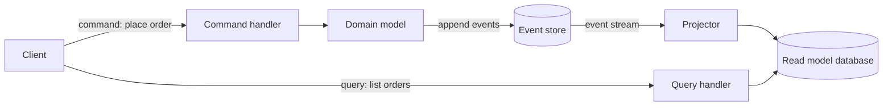

# 7. CQRS & Event Sourcing

[Previous: Hexagonal](06-hexagonal-architecture.md) | [All patterns](../README.md#the-patterns) | [Next: Layered / N Tier](08-layered-n-tier.md)

**Category:** Structural and data style (how one service handles writes, reads, and stored state)

## Overview

These are two separate ideas that are often used together.

**CQRS** (Command Query Responsibility Segregation) separates the model that changes data (commands) from the model that reads data (queries). Each side can then be shaped and scaled for its own job.

**Event sourcing** stores every change as an immutable event, instead of storing only the current state. The current state is rebuilt by replaying events. You can use CQRS without event sourcing, and event sourcing without CQRS.

## Diagram

The read side is updated after events are stored, so it can lag slightly behind the write side.

## How it works

* **Commands** express intent, such as "place order". They are validated and either succeed or are rejected.
* With event sourcing, a successful command appends events such as "order placed" to an event store. Events are never edited, only added.
* **Projectors** read events and build read models shaped for screens and reports.
* **Queries** read from those read models and never change data.
* **Snapshots** store periodic state so replay does not need to start from the first event every time.
* Without event sourcing, CQRS can be as simple as separate classes or tables for reads and writes in the same database.

## Pros

* **Optimized reads and writes:** Each side can use the best data shape and technology for its own workload.
* **Independent scaling:** Reads are often far more frequent than writes, and can scale separately.
* **Complete history (event sourcing):** Every change is kept, which helps auditing, debugging, and answering "what did the system know at that time?"
* **Rebuildable views (event sourcing):** New read models can be created by replaying old events.
* **Clear intent:** Commands and events capture business language explicitly.

## Cons

* **Significant complexity:** There are more moving parts, more concepts, and more code than a simple create, read, update, and delete design.
* **Eventual consistency:** After a write, the read side may not show the change right away, which users and developers must handle.
* **Event design is permanent:** Old events must remain readable forever, so schema changes need upcasting or versioning strategies.
* **Replay and rebuild costs:** Large event stores can take a long time to replay, and snapshots add more machinery.
* **Privacy and deletion are hard:** Deleting personal data from an append only log is difficult. Approaches such as encrypting per person data and discarding keys add complexity.
* **Tooling and skills are less common:** Fewer developers have production experience with it, so mistakes are more likely.
* **Easy to apply too early:** Many systems never need it. See "premature CQRS/ES" in the [decision guide](decision-guide.md).

## When to use

* The domain has complex rules and a strong audit requirement, such as finance, bookings, or ledgers.
* Read and write workloads differ greatly in volume or shape.
* You need to answer historical questions or rebuild state from past events.
* The team understands the trade offs and can support the extra complexity.

## When to avoid

* The application is mostly simple data entry or CRUD.
* Strong, immediate consistency between writes and reads is required everywhere.
* The team is new to the approach and the domain does not demand it.
* You only want an audit log. A simple audit table is usually enough.

## Common technologies

| Area | Examples |
|---|---|
| Event stores | KurrentDB (formerly EventStoreDB), PostgreSQL used as an event store, Apache Kafka as a log |
| Frameworks | Axon Framework (Java), Marten (.NET), EventSauce and Spatie laravel event sourcing (PHP) |
| Command and query handling | MediatR (.NET), Symfony Messenger, Laravel jobs and handlers |
| Read models | Relational tables, Elasticsearch or OpenSearch, Redis, document databases |

## Real world considerations

| Factor | What to expect |
|---|---|
| Team size | Best for teams with a shared grasp of the domain and the pattern. Not a good fit for teams that rotate quickly. |
| Operational maturity | Moderate to high. You need to monitor projection lag, manage replays, and plan for event schema changes. |
| Cost | Higher development and learning cost. Infrastructure cost is moderate, often one extra datastore. |

CQRS and event sourcing are structural and data choices inside a service. They are independent of how you deploy, so they can run in a [Monolith](01-monolith.md), in [Microservices](03-microservices.md), or on [Serverless](04-serverless.md) platforms. They are often paired with [Event Driven Architecture](05-event-driven-architecture.md), but event driven communication does not require event sourcing.

## Related patterns

* [Event Driven Architecture](05-event-driven-architecture.md): uses events to communicate. Event sourcing uses them as the source of truth.
* [Hexagonal](06-hexagonal-architecture.md) and [Clean / Onion](09-clean-onion-architecture.md): good ways to organize the code around commands and queries.
* [Microservices](03-microservices.md): a common deployment style for services that use these patterns.
* [Glossary](glossary.md): definitions of eventual consistency, idempotency, and projections.
