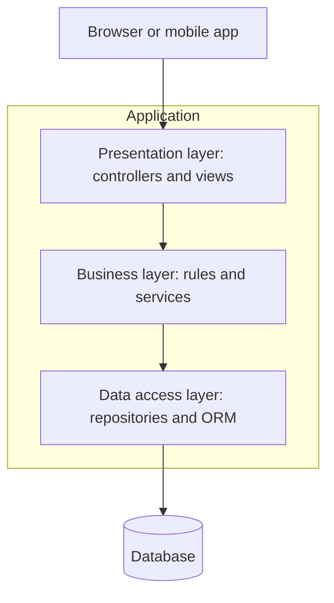

# 8. Layered / N-Tier

[Previous: CQRS & Event Sourcing](07-cqrs-and-event-sourcing.md) | [All patterns](../README.md#the-patterns) | [Next: Clean / Onion](09-clean-onion-architecture.md)

**Category:** Structural style (layers in code) and, for N tier, a physical deployment layout

## Overview

Layered architecture organizes code into horizontal layers, each with one responsibility. A typical set is presentation, business logic, and data access. A layer talks only to the layer directly below it. N tier is the physical version of the same idea: the layers (tiers) run on separate machines or services, such as a web tier, an application tier, and a database tier. People often use the two terms loosely, so it helps to ask whether someone means code layers or deployment tiers.

## Diagram

In an N tier deployment, each layer or group of layers may run on its own servers.

## How it works

* Each layer has a clear job. Presentation handles input and output, the business layer enforces rules, and the data layer reads and writes storage.
* Dependencies point downward. Higher layers call lower layers, not the other way round.
* A strict version allows calls only to the next layer. A relaxed version lets a layer skip down.
* In N tier, tiers are deployed separately and communicate over the network, often with firewalls between them.

## Pros

* **Familiar to most developers:** It is widely taught, and most frameworks follow it, so onboarding is easy.
* **Clear separation of concerns:** Screens, rules, and storage code are not mixed together.
* **Simple to organize:** There is an obvious place for each kind of code.
* **Layers can be replaced:** You can change the user interface or storage technology with limited impact on other layers, if the boundaries are kept clean.
* **Good tool support:** Frameworks, templates, and generators assume this structure.
* **Tier separation helps security and scaling:** In N tier, you can place a database in a protected network and scale web servers separately.

## Cons

* **Pass through layers:** Simple requests may flow through every layer without any logic, which adds code with little value.
* **Changes cut across layers:** Adding a field often touches presentation, business, and data code together.
* **Business logic leaks:** Rules end up in controllers or database code if the team is not careful.
* **Database centric designs:** Layers often depend on the database model, which can tie the domain to storage details.
* **Scaling is coarse:** Layers inside one deployable scale together. N tier helps only at tier level.
* **Network cost in N tier:** Each additional tier adds latency and more infrastructure to run.
* **Does not guide larger systems:** It says little about how to split a large domain into parts.

## When to use

* You are building a typical business application with standard workflows.
* The team wants a familiar, low risk structure.
* You need a simple starting point inside a [Monolith](01-monolith.md).
* Security rules call for separate tiers, such as a protected data zone.

## When to avoid

* The core business rules are complex and should not depend on the database or framework. Consider [Hexagonal](06-hexagonal-architecture.md) or [Clean / Onion](09-clean-onion-architecture.md).
* The system is large and needs independent team ownership by business area. Layers alone do not give you that.
* You want to run many independently scaling features. Consider a different deployment style.

## Common technologies

| Area | Examples |
|---|---|
| MVC and web frameworks | Laravel, Ruby on Rails, Django, Spring MVC, ASP.NET Core MVC |
| Data access | Eloquent, Hibernate, Entity Framework, SQLAlchemy |
| Tier infrastructure | Load balancers, web servers such as Nginx, application servers, managed databases |
| Layer enforcement | ArchUnit, Deptrac, NetArchTest |

## Real world considerations

| Factor | What to expect |
|---|---|
| Team size | Fits small and medium teams well. Large teams split by layer often wait on each other, so slicing by feature helps. |
| Operational maturity | Low. Standard hosting and deployment are enough. N tier adds some network and security setup. |
| Cost | Low development cost. In N tier, more servers and network configuration add infrastructure cost. |

Layered structure is the default inside many [Monoliths](01-monolith.md). It can also appear inside each [Microservice](03-microservices.md). A common refinement is to apply the dependency rule from [Clean / Onion](09-clean-onion-architecture.md) so that business rules do not depend on the data layer.

## Related patterns

* [Monolith](01-monolith.md): the usual home for a layered design.
* [Clean / Onion Architecture](09-clean-onion-architecture.md): inverts the dependency so the domain sits at the center.
* [Hexagonal](06-hexagonal-architecture.md): another way to isolate the business core from technology.
* [Service Oriented Architecture](10-service-oriented-architecture.md): often built from several tiers and shared services.
