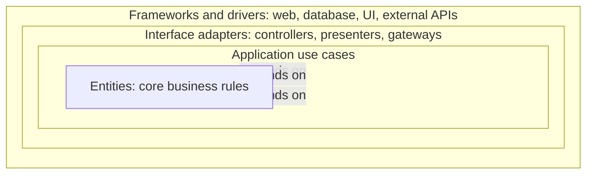

# 9. Clean / Onion Architecture

[Previous: Layered / N Tier](08-layered-n-tier.md) | [All patterns](../README.md#the-patterns) | [Next: Service Oriented Architecture](10-service-oriented-architecture.md)

**Category:** Structural style (how the code inside an application is organized)

## Overview

Clean architecture and onion architecture arrange code in concentric rings. The business rules sit in the center, and technical details such as frameworks, databases, and user interfaces sit in outer rings. The key rule is the dependency rule: source code dependencies may only point inward. Inner rings know nothing about outer rings. The two names come from different authors (Jeffrey Palermo for onion, Robert C. Martin for clean) and share the same core idea, with small differences in how many rings they describe and what they call them.

## Diagram

All arrows point inward. The database and web framework depend on the business rules, not the reverse.

## How it works

* **Entities** hold the most general business rules and have no outside dependencies.
* **Use cases** hold application specific rules that coordinate entities to achieve a goal.
* **Interface adapters** convert data between the use cases and the outside world, such as controllers, presenters, and repository implementations.
* **Frameworks and drivers** are the outermost details: the web framework, the database, and external services.
* Where an inner ring needs something from outside, it defines an interface and the outer ring implements it. This is dependency inversion.
* Data crossing a boundary is passed as simple structures, not framework specific objects.

## Pros

* **Independent of frameworks:** The framework is a detail you plug in, so upgrades and replacements have less impact on business rules.
* **Testable core:** Rules and use cases can be tested quickly without a database or web server.
* **Long term maintainability:** Rich domains stay understandable as they grow, because the rules are not scattered across layers.
* **Delayed technical decisions:** You can postpone choosing a database or UI technology.
* **Clear conventions:** The rings give teams a shared vocabulary for where code belongs.

## Cons

* **More structure and indirection:** Interfaces, mappers, and boundary objects add files and code.
* **Boilerplate for simple features:** A basic list screen may need many small classes.
* **Learning curve:** Teams new to the approach can misplace code or create rings with no real purpose.
* **Mapping and performance overhead:** Converting between models costs effort, and can cost runtime in hot paths.
* **Strictness can become dogma:** Following ring diagrams literally, without asking what they buy you, produces ceremony.
* **Does not decide deployment:** It leaves open how services are split and deployed.

## When to use

* The domain is complex and long lived, with business rules worth protecting.
* You want to keep the option to change frameworks, databases, or delivery methods.
* A team of several developers needs shared conventions for structuring code.
* You value fast, reliable unit tests of business behavior.

## When to avoid

* The application is mostly simple data entry or a thin layer over a database.
* The project is a short term prototype.
* The team cannot invest in learning the approach, and a simple [Layered](08-layered-n-tier.md) structure would meet the needs.

## Common technologies

This is a design approach and works in most languages that support interfaces or similar abstractions.

| Area | Examples |
|---|---|
| Frameworks that fit well | Spring Boot, ASP.NET Core, NestJS, Laravel, Symfony |
| Dependency injection | Built in containers of the frameworks above |
| Mapping helpers | MapStruct, AutoMapper, plain mapping functions |
| Boundary checks | ArchUnit, NetArchTest, Deptrac |

## Real world considerations

| Factor | What to expect |
|---|---|
| Team size | Useful for teams of several developers who need shared structure. A solo developer may find it heavy. |
| Operational maturity | No special operations needed. The effort is in design discipline and code review. |
| Cost | Higher up front development effort. Savings appear when requirements or technologies change over years. |

Clean and onion architecture describe internal structure only. You can apply them inside a [Monolith](01-monolith.md), a module of a [Modular Monolith](02-modular-monolith.md), a [Microservice](03-microservices.md), or a [Serverless](04-serverless.md) function.

## Related patterns

* [Hexagonal](06-hexagonal-architecture.md): a closely related idea. Clean and onion architecture name more specific rings.
* [Layered / N Tier](08-layered-n-tier.md): the traditional structure where dependencies run down to the database.
* [CQRS & Event Sourcing](07-cqrs-and-event-sourcing.md): often organized as use cases in the application ring.
* [Microservices](03-microservices.md): a deployment style that can contain services built this way.
