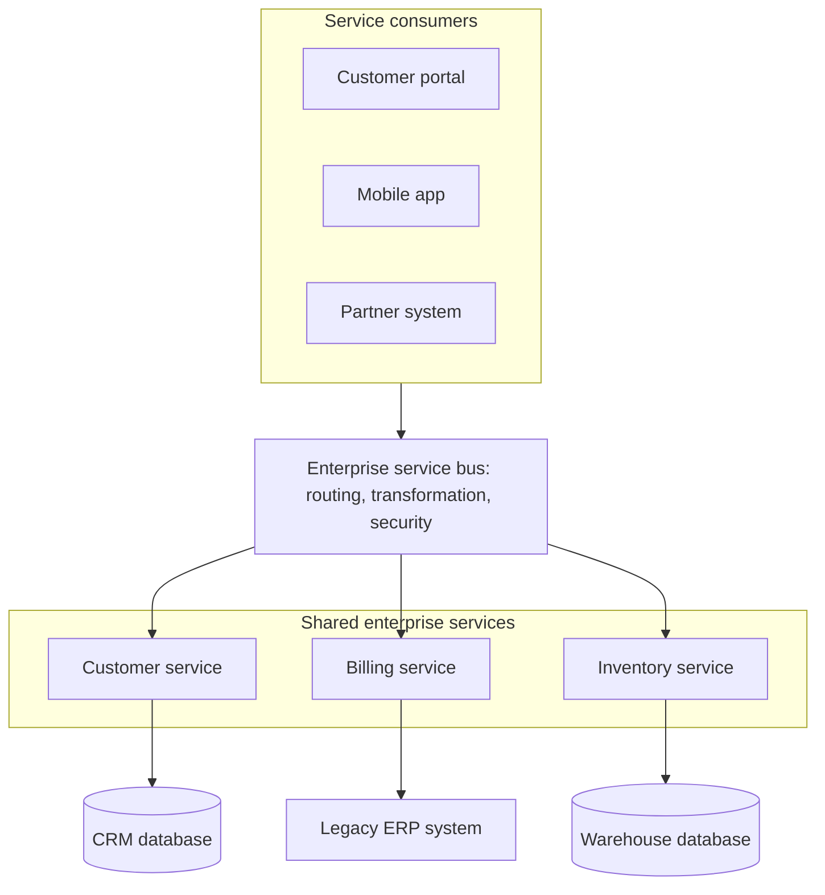

# 10. Service-Oriented Architecture (SOA)

[Previous: Clean / Onion](09-clean-onion-architecture.md) | [All patterns](../README.md#the-patterns) | [Next: Space Based Architecture](11-space-based-architecture.md)

**Category:** Deployment and integration style (enterprise scale)

## Overview

Service oriented architecture organizes an enterprise's capabilities as reusable services with published contracts. Different applications and business units call those shared services instead of each building their own copy. Classic SOA, popular in the 2000s, typically used XML and SOAP contracts and a central integration layer called an enterprise service bus (ESB) to route messages, transform data, and connect old and new systems. The term is used in different ways, so always check which flavor someone means.

## Diagram

## How it works

* Services represent business capabilities and are described by contracts, such as WSDL for SOAP services.
* Services are usually coarser than microservices, and are often shared across many applications.
* A central bus or integration layer handles routing, protocol translation, message transformation, and sometimes orchestration.
* A service registry or catalog helps teams discover and reuse services.
* Governance sets standards for contracts, security, and versioning across the organization.
* Services frequently wrap existing systems, such as an ERP or mainframe, to make them reachable in a uniform way.

## Pros

* **Reuse across the enterprise:** A capability built once can serve many applications and business units.
* **Integrates mixed systems:** The bus and contracts help connect legacy, packaged, and new systems.
* **Standard contracts:** Clear interfaces and governance make integration predictable at large scale.
* **Central control of cross cutting concerns:** Security, auditing, and routing rules can be enforced in one place.
* **Fits organizations with many existing systems:** It supports gradual integration without rewriting everything.

## Cons

* **The bus can become a bottleneck:** A central integration layer can be a single point of failure and a performance limit.
* **Logic accumulates in the middle:** Business rules that creep into the bus become hard to test, own, and change.
* **Heavy governance:** Shared contracts and committees can slow change, because many consumers depend on each service.
* **Verbose standards:** SOAP and the related WS standards can be complex and heavy compared with simple HTTP APIs.
* **Shared data models:** A common enterprise model can force compromises and create coupling between teams.
* **Release coordination:** Because services are shared, a change often needs agreement from many consumers.
* **Reuse is hard to achieve:** Services designed to be general can end up awkward for every consumer.

## When to use

* A large organization needs to integrate many existing systems and business units.
* Reuse of well defined business capabilities across applications is a real goal.
* Central governance, security, and auditing are required.
* You are wrapping legacy systems so newer applications can use them.

## When to avoid

* A small or mid sized team is building a single product. The overhead is unlikely to pay off.
* Teams need to move fast and release independently, without central coordination.
* You would be adopting a heavy bus mainly because it is available.
* The integration needs are simple and a few direct API calls would do.

## Common technologies

| Area | Examples |
|---|---|
| Contracts and protocols | SOAP, WSDL, XML Schema, WS Security, and also REST with JSON |
| Integration platforms | MuleSoft Anypoint, WSO2, IBM App Connect, Oracle Service Bus, Apache ServiceMix and Apache Camel |
| Orchestration | BPEL and business process engines |
| Governance | Service registries, API management platforms |

## Real world considerations

| Factor | What to expect |
|---|---|
| Team size | Suits large organizations with several teams and a central architecture or integration group. |
| Operational maturity | Moderate to high. Needs governance processes, integration platform expertise, and careful versioning. |
| Cost | Platform licenses or operations, specialist skills, and the ongoing cost of governance. Value comes from reuse and integration. |

Some people see microservices as an evolution of service oriented ideas, with smaller services, decentralized ownership, and lighter communication. Others emphasize that they are different in important ways. This repository treats them as separate patterns and compares them in the [comparison page](comparison.md). In practice, many organizations run both.

## Related patterns

* [Microservices](03-microservices.md): smaller, decentralized services, usually without a central bus.
* [Event Driven Architecture](05-event-driven-architecture.md): message based integration, often used within service landscapes.
* [Layered / N Tier](08-layered-n-tier.md): individual services are often built as layered applications.
* [Monolith](01-monolith.md): SOA often wraps one or more large existing systems.
