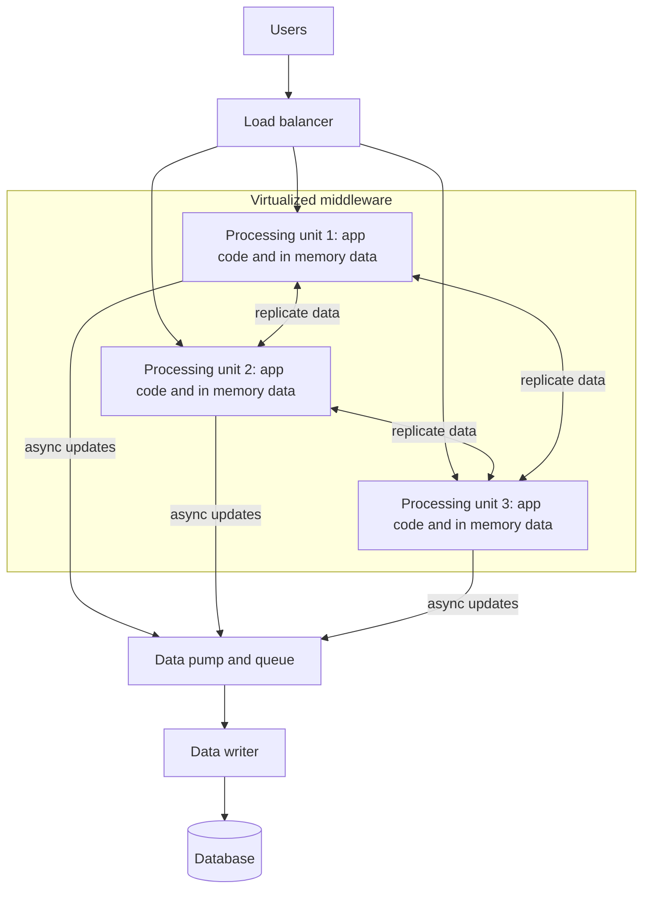

# 11. Space-Based Architecture

[Previous: Service Oriented Architecture](10-service-oriented-architecture.md) | [All patterns](../README.md#the-patterns)

**Category:** Deployment and scaling style (data and processing scaled together)

## Overview

Space based architecture is built for very high, unpredictable load. Instead of every request hitting a central database, the application keeps its working data in memory, replicated across many identical processing units. You add or remove units to follow demand. The database is updated in the background, not in the request path. The name comes from the "tuple space" idea of shared memory that many workers can read and write. The pattern is often described in software architecture literature as a way to remove the database as the scaling bottleneck.

## Diagram

## How it works

* **Processing units** contain application logic and an in memory copy of the data they need.
* A **data grid** keeps that data synchronized across units, so any unit can answer a request.
* **Messaging** moves requests and updates between parts of the grid.
* A **data pump** sends changes to a queue, and data writers apply them to the database asynchronously.
* A **deployment manager** starts and stops processing units as load rises and falls.
* The database is for durability, reporting, and recovery, not for serving each request.

## Pros

* **High elasticity:** Capacity grows and shrinks quickly by adding or removing processing units.
* **Avoids the database bottleneck:** Requests are served from memory rather than waiting on a central database.
* **Handles sudden spikes:** It suits workloads where traffic can jump from low to extreme in moments.
* **High availability potential:** Replicated data lets other units continue if one unit fails.
* **Low latency reads and writes:** In memory access is fast compared with remote database calls.

## Cons

* **High complexity:** Data replication, grid management, and recovery are demanding to design and operate.
* **Eventual consistency with the database:** The persistent store lags behind memory, and a failure at the wrong time needs careful handling.
* **Memory limits and cost:** All the working data must fit in memory across the grid, and memory is more expensive than disk.
* **Data conflicts:** Concurrent updates in different units need clear resolution rules.
* **Hard to test and debug:** Behavior under load, replication delays, and failures is difficult to reproduce.
* **Specialized skills and products:** Fewer engineers have experience, and strong in memory grid products can bring licensing cost or lock in.
* **Poor fit for large, relational data:** Complex queries over huge datasets do not map well to in memory grids.

## When to use

* The workload has extreme, unpredictable spikes, such as ticket sales, flash sales, or live events.
* Database contention is the main limiting factor, and ordinary caching and replicas are not enough.
* The working data set is small enough to hold in memory.
* Temporary lag between memory and the database is acceptable.

## When to avoid

* Traffic is steady or modest, where simpler scaling would do.
* Strict, immediate consistency in the database is required for every operation.
* The data set is very large or needs complex relational queries.
* The team has no experience with data grids and no appetite for the operational complexity.

## Common technologies

| Area | Examples |
|---|---|
| In memory data grids | Hazelcast, Apache Ignite, Oracle Coherence, Infinispan, Apache Geode |
| Commercial platforms | GigaSpaces, VMware GemFire |
| Messaging | Kafka, RabbitMQ, built in grid messaging |
| Orchestration | Kubernetes or the grid product's own deployment manager |
| Caches that cover part of the idea | Redis, Memcached |

## Real world considerations

| Factor | What to expect |
|---|---|
| Team size | Needs a team with strong distributed systems skills. Often a specialist group for the grid. |
| Operational maturity | High. You need to manage memory, replication, failure recovery, and data reconciliation. |
| Cost | High for memory and for specialist skills or product licenses. Worth it only when the load truly demands it. |

Many systems that think they need this pattern are better served by caching, read replicas, or a queue in front of the database. Try those first and measure.

## Related patterns

* [Event Driven Architecture](05-event-driven-architecture.md): asynchronous messaging is central to how the grid and data pump work.
* [Serverless](04-serverless.md): another route to elastic scaling, with a very different cost and control profile.
* [Microservices](03-microservices.md): processing units can be deployed as services.
* [CQRS & Event Sourcing](07-cqrs-and-event-sourcing.md): also separates the write path from persistent reads.
