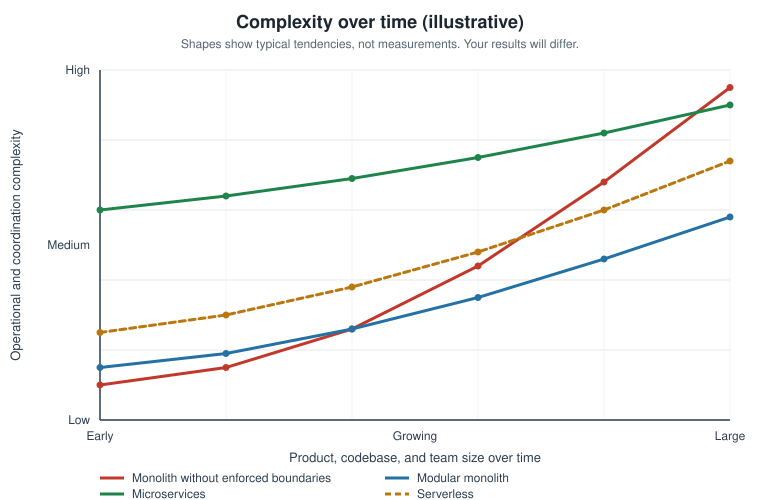

# Comparison

[Back to the README](../README.md) | [Decision guide](decision-guide.md) | [Glossary](glossary.md)

This page compares all eleven patterns side by side. The ratings are broad generalizations. Real outcomes depend on the team, the domain, and how well each pattern is applied, so treat the tables as a starting point for discussion and not as scores.

## Two different kinds of choice

The patterns answer different questions, so they are not all competing alternatives.

| Kind | Question it answers | Patterns |
|---|---|---|
| Deployment and scaling styles | How is the system packaged, deployed, and scaled? | [Monolith](01-monolith.md), [Modular Monolith](02-modular-monolith.md), [Microservices](03-microservices.md), [Serverless](04-serverless.md), [SOA](10-service-oriented-architecture.md), [Space Based](11-space-based-architecture.md) |
| Structural and communication styles | How is code organized inside a unit, and how do parts talk to each other? | [Layered / N Tier](08-layered-n-tier.md), [Hexagonal](06-hexagonal-architecture.md), [Clean / Onion](09-clean-onion-architecture.md), [CQRS & Event Sourcing](07-cqrs-and-event-sourcing.md), [Event Driven](05-event-driven-architecture.md) |

> **Patterns combine.** Hexagonal, Clean / Onion, CQRS, and Event Driven describe internal structure or communication style. They can be used inside a monolith, inside each microservice, or inside serverless functions. A realistic system might be a modular monolith whose modules use hexagonal structure, plus a few serverless functions triggered by events.

## Deployment and scaling styles

| | [Monolith](01-monolith.md) | [Modular Monolith](02-modular-monolith.md) | [Microservices](03-microservices.md) | [Serverless](04-serverless.md) | [SOA](10-service-oriented-architecture.md) | [Space Based](11-space-based-architecture.md) |
|---|---|---|---|---|---|---|
| Deployable units | One | One | Many, small | Many functions or small services | Several, often coarse | Many identical processing units |
| How it scales | Whole app, as copies | Whole app, as copies | Each service on its own | Automatically per function | Per service, often with a central bus | Add or remove processing units |
| Data ownership | One shared database | Shared server, separate schemas per module | Each service owns its data | Managed services, often one per function group | Services own data, often with shared models | In memory grid, database updated later |
| Release independence | Low | Low to medium | High | High per function | Medium | Medium |
| Fault isolation | Low | Low | High if designed well | High per function | Medium | Medium to high |
| Consistency | Easy, ACID | Easy, ACID within the app | Eventual across services | Eventual across functions | Mixed | Eventual to the database |
| Initial effort | Low | Low to medium | High | Low to medium | High | Very high |
| Operational burden | Low | Low | High | Medium | Medium to high | High |
| Typical main risk | Coupling and big releases | Boundaries erode | Distributed monolith, overhead | Lock in, cold starts, cost at steady load | Central bus bottleneck, governance drag | Complexity, memory cost |
| Team size sweet spot | One to a few teams | A few teams | Many teams | Any, especially small teams | Large organizations | Specialist team |

## Structural and communication styles

| | [Layered / N Tier](08-layered-n-tier.md) | [Hexagonal](06-hexagonal-architecture.md) | [Clean / Onion](09-clean-onion-architecture.md) | [CQRS & Event Sourcing](07-cqrs-and-event-sourcing.md) | [Event Driven](05-event-driven-architecture.md) |
|---|---|---|---|---|---|
| What it organizes | Code in horizontal layers, or physical tiers | Core logic with ports and adapters | Concentric rings with inward dependencies | Separate write and read models, optionally events as storage | How components communicate through events |
| Main idea | Each layer has one job | Core does not depend on infrastructure | Dependencies point inward | Commands change, queries read | Announce facts, let others react |
| Fits inside | Any deployment style | Any deployment style | Any deployment style | Any deployment style | Any deployment style |
| Effect on consistency | None | None | None | Eventual between write and read sides | Eventual between producers and consumers |
| Testability | Medium | High | High | Medium | Medium, needs good tooling |
| Learning curve | Low | Medium | Medium | High | Medium to high |
| Boilerplate | Low | Medium | Medium to high | High | Medium |
| Typical main risk | Pass through layers, logic leaks | Over abstraction | Ceremony without payoff | Premature use, event versioning | Hard to trace flows, duplicates |

## Quick ratings across all patterns

Ratings run from Low to High. For "Simplicity at the start", High means easier. For "Operational burden", High means more work.

| Pattern | Simplicity at the start | Operational burden | Independent scaling | Team autonomy | Easy strong consistency |
|---|---|---|---|---|---|
| [Monolith](01-monolith.md) | High | Low | Low | Low | High |
| [Modular Monolith](02-modular-monolith.md) | Medium | Low | Low | Medium | High |
| [Microservices](03-microservices.md) | Low | High | High | High | Low |
| [Serverless](04-serverless.md) | Medium | Medium | High | Medium to high | Low |
| [Event Driven](05-event-driven-architecture.md) | Medium | Medium to high | High | High | Low |
| [Hexagonal](06-hexagonal-architecture.md) | Medium | Low | Not applicable | Not applicable | Not applicable |
| [CQRS & Event Sourcing](07-cqrs-and-event-sourcing.md) | Low | Medium to high | Medium to high | Medium | Low |
| [Layered / N Tier](08-layered-n-tier.md) | High | Low | Low (higher for N tier) | Low | High |
| [Clean / Onion](09-clean-onion-architecture.md) | Medium | Low | Not applicable | Not applicable | Not applicable |
| [SOA](10-service-oriented-architecture.md) | Low | Medium to high | Medium | Medium | Medium |
| [Space Based](11-space-based-architecture.md) | Low | High | Very high | Low | Low |

"Not applicable" means the pattern says nothing about that property, because it only describes internal code structure.

## Complexity over time

The chart below is **illustrative, not measured data**. It shows a common story: a monolith without enforced boundaries is simple at first and becomes harder to change as it grows. A modular monolith keeps growth gentler. Microservices pay a high fixed cost up front, then grow more slowly, and serverless sits between them with its own kinds of cost. Real projects vary a lot, and good practice can change any of these lines.

Text version of the same idea:

| Stage | Monolith without enforced boundaries | Modular Monolith | Microservices | Serverless |
|---|---|---|---|---|
| Early | Low | Low | Medium to high | Low to medium |
| Growing | Low to medium | Low to medium | Medium to high | Medium |
| Large | High | Medium | High | Medium to high |

## Key takeaways

* **There is no best pattern.** Each one trades something for something else. The right choice depends on your team, your domain, and your constraints.
* **Separate the questions.** Choose a deployment style, an internal structure, and a communication style as three decisions, not one.
* **Distribution has a price.** Every network boundary adds failure modes, latency, and consistency problems. Pay that price only for a reason you can name.
* **Start simple and keep options open.** A well structured [modular monolith](02-modular-monolith.md) or a clean internal design is cheap to build and makes later changes easier.
* **Match architecture to your organization.** Independent services help when teams really need to work independently. See Conway's law in the [glossary](glossary.md).
* **Measure before adopting.** Heavy patterns such as [CQRS & Event Sourcing](07-cqrs-and-event-sourcing.md) and [Space Based](11-space-based-architecture.md) pay off only when a measured problem calls for them.
* **Patterns evolve.** Systems often change style over time, in either direction. The [case studies](case-studies/README.md) show real examples.

For a guided way to narrow the options, see the [decision guide](decision-guide.md).
