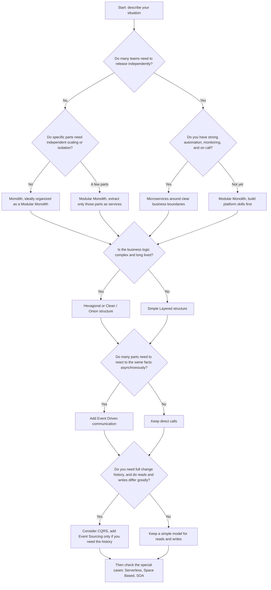

# Decision Guide

[Back to the README](../README.md) | [Comparison](comparison.md) | [Glossary](glossary.md)

This guide helps you narrow down options. It is a thinking aid, not a rulebook. Real projects have constraints no flowchart captures, so use it to start a conversation with your team and then test your choice against your actual situation.

## Decision flowchart

The flow chooses a deployment style first, then an internal structure, then a communication style and a data approach. These are separate decisions that combine. See the [comparison](comparison.md).

If the diagram does not render in your viewer, use the [exported SVG](../assets/diagrams/decision-guide.svg).

### Special cases

Check these after the main flow. Each applies only in specific situations.

| Pattern | Consider it when | Be careful if |
|---|---|---|
| [Serverless](04-serverless.md) | Work is spiky, mostly idle, or event triggered, and you want to avoid running servers. | Load is steady and high, latency must be very consistent, or you must avoid provider lock in. |
| [Space Based](11-space-based-architecture.md) | Extreme, unpredictable spikes keep the database as the bottleneck even after caching and replicas. | Load is modest, or you need strict immediate consistency. |
| [SOA](10-service-oriented-architecture.md) | A large organization must integrate many existing systems under shared governance. | You are building a single product with a single team. |

## Questions to ask

Answer these with your team before choosing. The "points toward" column shows tendencies, not rules.

| Question | Why it matters | Points toward |
|---|---|---|
| How many teams will work on this, and must they release independently? | Architecture should match how people work. Independent releases are the main benefit of services. | One or two teams: [Monolith](01-monolith.md) or [Modular Monolith](02-modular-monolith.md). Many teams: [Microservices](03-microservices.md). |
| How well do you understand the domain boundaries? | Wrong service boundaries are expensive to fix across a network. | Unclear boundaries: stay in one deployable. Clear boundaries: services become safer. |
| What does your traffic look like? | Steady, spiky, and idle workloads have different cost and scaling profiles. | Spiky or idle: [Serverless](04-serverless.md). Steady: servers or containers are often cheaper. |
| What consistency do business rules need? | Cross service transactions are hard. | Strong consistency needs: fewer deployable units. Tolerance for delay: [Event Driven](05-event-driven-architecture.md). |
| How mature are deployment, monitoring, and on call? | Distribution multiplies operational work. | Low maturity: keep it simple. High maturity: more options open up. |
| What are the availability and fault isolation needs? | A failure in one place should not take down everything critical. | High isolation needs: separate deployables. |
| What are the latency requirements? | Network hops and cold starts add delay. | Very low latency: fewer hops, warm capacity, or [Space Based](11-space-based-architecture.md). |
| Are there security or compliance boundaries? | Some data must be separated or audited. | Strict separation: separate services, tiers, or accounts. Strong audit trail: consider [Event Sourcing](07-cqrs-and-event-sourcing.md). |
| What is the budget model? | Pay per use and fixed capacity behave very differently. | Small or uncertain budget: simpler options. Predictable high load: reserved capacity. |
| How long will this code live, and how likely are technology changes? | Long lived rules benefit from isolation from frameworks. | Long lived and complex: [Hexagonal](06-hexagonal-architecture.md) or [Clean / Onion](09-clean-onion-architecture.md). Short lived: keep it simple. |
| Which existing systems must you integrate? | Legacy systems shape what is practical. | Many legacy systems: [SOA](10-service-oriented-architecture.md) style integration or an event backbone. |
| What skills does the team already have? | Unfamiliar patterns slow delivery and raise risk. | Choose what the team can operate well, and plan time to learn the rest. |

## Common anti patterns

### Distributed monolith

* **What it is:** A system split into services that must still be changed and deployed together.
* **Symptoms:** One feature needs changes in many services. Services share a database. Releases are coordinated across teams. A single failure cascades everywhere.
* **Why it happens:** Services were split along technical layers or by guesswork, before boundaries were understood.
* **Better approach:** Keep a [Modular Monolith](02-modular-monolith.md) until boundaries are stable. Split by business capability, and give each service its own data.

### Nano services

* **What it is:** Services so small that the overhead of running and connecting them outweighs their value.
* **Symptoms:** Many services with a few lines of logic each. Simple requests cross a long chain of calls. Most effort goes into plumbing, not features.
* **Why it happens:** A "smaller is better" rule applied without asking what each boundary buys.
* **Better approach:** Size services around a business capability and a team. Merge services that always change together.

### Resume driven architecture

* **What it is:** Choosing technologies or patterns mainly because they are fashionable or look good on a resume, not because the problem needs them.
* **Symptoms:** Complex tooling for a small product. Nobody can explain the specific problem a technology solves.
* **Why it happens:** Hype, personal incentives, and conference talks that describe problems the team does not have.
* **Better approach:** Write down the problem and the measured evidence first. Record the decision in an [ADR](adr/0000-adr-template.md) and review it honestly.

### Premature CQRS and Event Sourcing

* **What it is:** Adopting [CQRS & Event Sourcing](07-cqrs-and-event-sourcing.md) for an application that is mostly simple create, read, update, and delete work.
* **Symptoms:** Large amounts of code for simple screens. Developers struggle with eventual consistency and event versioning. An audit log was the only real need.
* **Why it happens:** The pattern looks elegant, and its benefits are real in the right domain.
* **Better approach:** Start with a simple model. Add a read model when reads become a measured problem. Use event sourcing only when you truly need the full history of changes.

### Shared database between services

* **What it is:** Several services reading and writing the same tables.
* **Symptoms:** A schema change breaks other services. Nobody knows who owns what data.
* **Why it happens:** It feels like the quickest way to share data.
* **Better approach:** Give each service its own data and expose it through an API or events.

### Big bang rewrite

* **What it is:** Replacing a working system entirely with a new architecture in a single large project.
* **Symptoms:** A long period with no delivered value. Old and new systems drift apart. Deadlines slip.
* **Why it happens:** Frustration with the old system and optimism about the new one.
* **Better approach:** Migrate in small steps. A common technique is the strangler fig approach, described in the [glossary](glossary.md).

### Modular monolith in name only

* **What it is:** A codebase with folders called modules, but no enforced boundaries.
* **Symptoms:** Modules freely call each other's internals and share tables.
* **Why it happens:** Enforcement tooling was never set up, so deadlines won.
* **Better approach:** Add automated boundary checks and review them like tests. See [Modular Monolith](02-modular-monolith.md).

## What to do next

1. Write down your constraints and the problem you are solving.
2. Pick the simplest option that fits, and note what would make you change your mind.
3. Record the decision in an ADR. See the [template](adr/0000-adr-template.md) and a [worked example](adr/0001-start-as-a-modular-monolith.md).
4. Revisit the decision when your situation changes.
