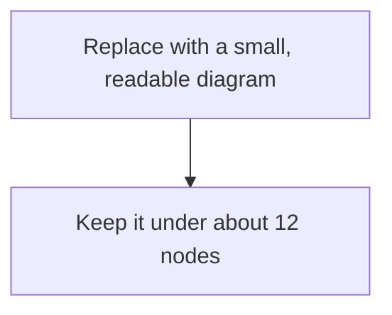

# NN. Pattern Name

<!--
How to use this template:
1. Copy it to docs/NN-pattern-name.md (lowercase, words joined by hyphens, two digit number).
2. Replace every placeholder in curly braces.
3. Keep every section and keep the order. Delete these comments when you are done.
4. Navigation and related links below are shown as code so they do not count as broken links. Turn them into real links.
5. Stay neutral. Every pattern has real costs, and none is the best choice for everyone.
6. Keep sections short. Prefer tables and short lists over long paragraphs.
-->

`[Previous: Previous Pattern](NN-previous-pattern.md) | [All patterns](../README.md#the-patterns) | [Next: Next Pattern](NN-next-pattern.md)`

**Category:** {Deployment and scaling style, Structural style, or Communication style}

## Overview

{Two to four sentences in plain language. What is it, and what problem does it try to solve? Avoid jargon, or define it in docs/glossary.md.}

## Diagram

## How it works

* {Key idea 1}
* {Key idea 2}
* {Key idea 3}

## Pros

* **{Short label}:** {One sentence explaining the benefit and why it holds.}
* **{Short label}:** {One sentence.}
* **{Short label}:** {One sentence.}

## Cons

* **{Short label}:** {One sentence explaining the cost and when it hurts.}
* **{Short label}:** {One sentence.}
* **{Short label}:** {One sentence.}

## When to use

* {Situation where this pattern is a good fit.}
* {Situation.}

## When to avoid

* {Situation where this pattern is a poor fit.}
* {Situation.}

## Common technologies

| Area | Examples |
|---|---|
| {Area} | {Tool, framework, or product names} |

## Real world considerations

| Factor | What to expect |
|---|---|
| Team size | {Typical team size or structure that suits this pattern.} |
| Operational maturity | {What the team needs to be good at: deployment, monitoring, on call, and so on.} |
| Cost | {Where the money goes: infrastructure, people, tooling, time.} |

## Related patterns

* `[{Related pattern}](NN-related-pattern.md)`: {One line on how it relates.}
* `[{Related pattern}](NN-related-pattern.md)`: {One line on how it relates.}
